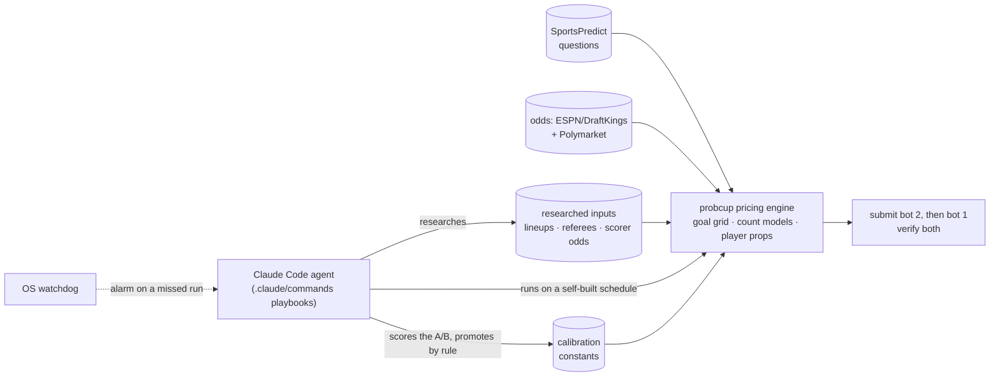

# Probability Cup: an agent-operated forecasting system

A calibrated forecasting engine for the 2026 FIFA World Cup, operated in production for 38 days
by a Claude Code agent: it scheduled its own pre-kickoff runs, researched the facts the betting
market misses, submitted to two leaderboard entries, verified every submission, and ran a live
A/B experiment on the second entry.

**#17 of 4,013** overall (bot 1) · **#5 of 4,013** in the knockout stage (bot 2) · 2,218 settled forecasts

[](https://github.com/im-yifanluo/jump-probability-cup/actions/workflows/ci.yml)

<picture>
  <source media="(prefers-color-scheme: dark)" srcset="results/figures/cumulative_points-dark.svg">
  
</picture>

## The challenge

The [Jump Trading Probability Cup](https://www.jumptrading.com/signals/introducing-the-jump-trading-probability-cup)
asked about ten yes/no questions per World Cup match — will this player have a shot on
target, will there be 5+ cards, will a goal come before the first hydration break — answered
with a probability before kickoff. Each forecast was scored against the field: the average
participant's Brier score minus yours, ×2 in the knockouts and ×3 in the final. Bots were
allowed, two per person, each ranked as its own entry. More in [docs/competition.md](docs/competition.md).

Because the score is a proper scoring rule, the best strategy is the most accurate honest
probability, never a bold one. The edge has to come from being better calibrated than the crowd
where the crowd is biased, covering every question type, and having sharper inputs.

## How it works



- **Anchor on the market.** The engine never rates teams itself. It fits a Dixon-Coles
  scoreline grid to the de-margined bookmaker and Polymarket odds, and answers every goal
  question from that one grid, so no two answers contradict each other.
- **Model what the market doesn't price.** Cards, corners, shots on target and offsides use
  negative-binomial models trained on ~116k club matches with the odds-implied scoring rates
  as inputs, corrected to tournament levels and to the referee's strictness.
- **Players from the confirmed lineup.** Expected minutes come from the starting XI, pulled
  automatically before kickoff; a researched scorer price for the exact fixture replaces the model.
- **Every question type.** 65 families, from "more corners than" to "first goal by a
  single-digit shirt"; all 1,153 questions on the archived boards parse, and new knockout
  families were built and tested the day they appeared.

Details: [architecture](docs/architecture.md) · [per-question methodology](docs/methodology.md) ·
[strategy and the evidence behind each constant](docs/strategy.md) · [research](research/README.md).

## How it ran

The agent worked from three playbooks ([`.claude/commands/`](.claude/commands/)): a morning run
that scored yesterday, set bot 2's experiment, submitted both bots and then **scheduled the
day's passes itself** 50 minutes before each kickoff; a final pass per kickoff wave with the
confirmed lineup, referee and scorer odds; and a night run that also priced tomorrow. It never
produced a probability itself: research entered only as per-match inputs, and bot 1 changed
only when a bot-2 probe won on its own settled markets. When session-only scheduling failed
on a restart, the fix was an alert-only watchdog, because a low-quality automatic submission
can lose points while a skipped refresh costs only freshness.

254 logged pipeline runs · 17,005 submission actions · 110 run reports · 21 memory notes ·
every A/B verdict in [the experiment log](agent/logs/experiment_log.md).
The daily cycle, guardrails and what went wrong: **[agent/README.md](agent/README.md)** ·
how it evolved, directive by directive: [agent/timeline.md](agent/timeline.md).

## Results

| Entry | Overall | Knockout stage | Points | Brier | Beat the crowd on |
|---|---|---|---|---|---|
| Bot 1 (stable model) | **#17** of 4,013 | #8 | +4,732 | 0.2197 | 69.1% of 1,183 markets |
| Bot 2 (A/B bench) | #31 | **#5** | +4,451 | 0.2174 | 69.7% of 1,035 markets |

<picture>
  <source media="(prefers-color-scheme: dark)" srcset="results/figures/points_by_category-dark.svg">
  
</picture>

Per market, the soft markets paid most (timing windows +8.4, player shots on target +5.7,
cards +5.3), where the crowd over-prices events; on results and goal totals the crowd follows
the same betting market and the edge is thinner (+3.9). Pricing below the crowd paid more the
further it went; the final alone was worth +501.6 to bot 1. Calibration, the A/B record and
the rest: [docs/results.md](docs/results.md).

## Try it

```bash
make setup     # .venv with the exact tournament dependencies (Python 3.11+, tested on 3.13)
make demo      # reprice the World Cup final offline — no API keys needed
make test      # 54 offline tests, including the golden equivalence suite (~30 s)
```

```
Spain vs Argentina — priced offline
 ours  sent  crowd  result  points  market
  51%   51%    66%      NO   +62.0  Will the first goal of the match be credited with an assist?
  40%   40%    45%      NO   +29.0  Will Argentina win the World Cup?
  10%   10%    40%      NO   +57.3  Will there be 5 or more total cards?
  20%   20%    46%      NO   +64.4  Will there be 5 or more offsides?
  ...
Recomputed offline: 19 of 20 forecasts equal what bot 1 submitted (to the whole percent).
Bot 1 on this board: +501.6 points against the crowd, mean Brier 0.208; beat the crowd on 15 of 20 markets.
```

`probcup --help` lists every tool: the production run, single-match pricing, lineup pulls,
scheduling, the watchdog, and the evaluation suite (ledger, A/B replay, drift, club backtest).
The live commands need SportsPredict keys in `.env` ([.env.example](.env.example)); the
competition is over, so they are here as the record of how it ran.

## Repository

```
src/probcup/       the package: sportspredict · questions · sources · models · pipeline · ops · evaluation
.claude/commands/  the agent's playbooks
agent/             how it was operated: daily cycle, guardrails, incidents, timeline, memory, logs
research/          the study behind every tuned constant, and two models that were rejected
results/           the platform's settled-results export, figures, and the script that builds them
examples/          the 101 real boards and the final's recovered odds, for the demo
data/              fitted models and researched inputs as they stood for the final
docs/              competition · architecture · methodology · strategy · results · API notes
tests/             offline tests and golden recordings of the tournament code
```

## Verified to behave exactly as it did live

This repository was restructured after the tournament. Before anything moved, the code that
ran the final (tag [`tournament-final`](../../tree/tournament-final)) was run against a fake
outside world and recorded: 1,153 real markets priced for both bots, and 13 command scenarios
down to every HTTP request and file written. The restructured package reproduces all of it
exactly ([tests/golden](tests/golden/README.md)), and the ten research studies and the full
club backtest give byte-identical output before and after.

## Known issues

Found in a post-tournament audit and deliberately left as they ran, so the archive matches the
live system:

- "Will a substitute score **or assist**?" is misparsed as a player named "a substitute" and
  priced at the generic player prior (~0.21), including in the final. The "…score?" phrasing is
  handled correctly.
- `probcup run` can stop before submitting either bot if ESPN's team names fail to orient
  (it raises `SystemExit`, which the per-match error handling doesn't catch), or if bot 2's key
  is present but empty in `.env`.
- `--dry-run` still writes the lineup file and the logs.
- `probcup player-rates` drops a player's whole override entry, researched scorer price
  included, when the player has fewer than 10 club appearances.
- The club backtest rewrites `data/models/count_models.json` as a side effect, and the
  knockout-era total-level scales are not gated to tournament mode, so a re-run today scores
  total shots on target and cards worse than the June 13 run the published results come from.

## Data and acknowledgements

Event data from [StatsBomb open data](https://github.com/statsbomb/open-data); club results
and closing odds from [football-data.co.uk](https://www.football-data.co.uk/); live odds from
ESPN (DraftKings) and [Polymarket](https://polymarket.com/); player season rates from
[API-Football](https://www.api-football.com/). Not affiliated with Jump Trading, SportsPredict
or FIFA.
