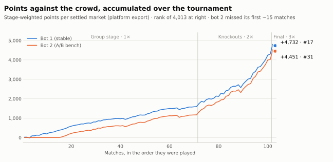
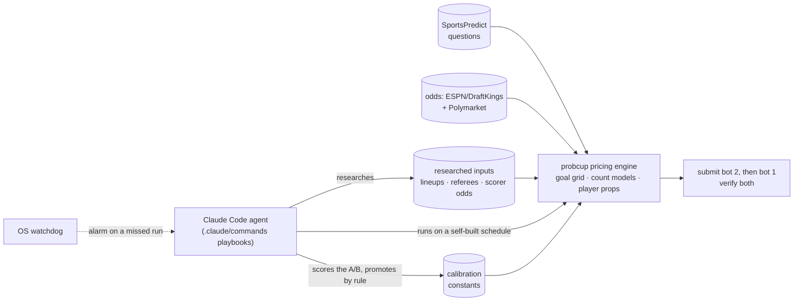
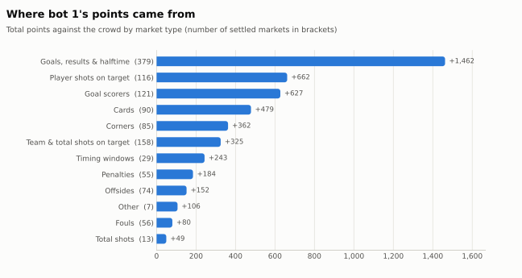

# Probability Cup forecasting system

[](https://github.com/im-yifanluo/jump-probability-cup/actions/workflows/ci.yml)
[](pyproject.toml)
[](LICENSE)
[](paper/report.pdf)

A calibrated World Cup forecasting system, run in production for 38 days by a Claude Code agent.

<picture>
  <source media="(prefers-color-scheme: dark)" srcset="results/figures/cumulative_points-dark.svg">
  
</picture>

The [Jump Trading Probability Cup](https://www.jumptrading.com/signals/introducing-the-jump-trading-probability-cup)
asked for a probability on about ten yes/no questions per match of the 2026 FIFA World Cup and
ranked 4,013 entries against the field. This system entered two bots. Its engine anchors every
answer on betting-market odds and prices 65 question families consistently; a Claude Code agent
operated it, scheduling its own pre-kickoff runs, researching inputs the market misses,
submitting and verifying both entries, and running a live A/B test on the second.

**Bot 1 finished #17 of 4,013 overall; bot 2 finished #5 in the knockout stage.**
The method and the full analysis are in the [technical report](paper/report.pdf).

- **Market-anchored engine.** One Dixon-Coles scoreline grid, fitted to de-margined odds,
  answers every goal question; negative-binomial count models driven by the odds-implied
  scoring rates cover corners, cards, shots, fouls and offsides; player props follow the
  confirmed lineup.
- **Agent operations.** 254 pipeline runs and 17,005 submission actions over 38 days, under
  explicit guardrails: match-scoped inputs, verified submissions, alarms instead of automatic
  fallbacks.
- **Live experimentation.** The second entry was an A/B bench; a constant reached the ranked
  entry only by winning its own settled markets.
- **Reproducible archive.** Golden tests recorded from the code that ran the final pin every
  price, request and file write; `make demo` reprices the final offline.

> [!NOTE]
> The tournament ended on July 19, 2026. This repository is the system as it ran in the final.
> The demo, the tests and the report build run offline; the research scripts need the public
> data from `probcup download-data`; the live commands need the competition's API keys and are
> kept as the record of how it ran.

## Contents

- [Background](#background)
- [Getting started](#getting-started)
- [How it works](#how-it-works)
- [How the agent ran it](#how-the-agent-ran-it)
- [Results](#results)
- [Technical report](#technical-report)
- [Project structure](#project-structure)
- [Reproducibility](#reproducibility)
- [Known issues](#known-issues)
- [Acknowledgements](#acknowledgements)
- [License](#license)

## Background

Each of the 104 matches carried about ten questions: will this player have a shot on target,
will there be 5+ cards, will a goal come before the first hydration break. Each answer was a
whole-number probability, due at kickoff. A forecast scored its Brier score against the field
average, times 2 in the knockouts and 3 in the final; bots were allowed, two per person, each
ranked as its own entry.

Because the Brier score is a proper scoring rule, the best report is always the honest
probability, never a bold one. The edge has to come from being better calibrated than the crowd
where the crowd is biased, answering every question, and having sharper inputs. The full rules
and their consequences are in [docs/competition.md](docs/competition.md).

## Getting started

### Prerequisites

- Python 3.11 or newer (CI runs 3.13)
- `make` and a POSIX shell (Linux or macOS)
- No API keys for the demo, the tests or the research scripts
- For the report only: a TeX distribution with `pdflatex` and `latexmk`

### Installation

```bash
git clone https://github.com/im-yifanluo/jump-probability-cup.git
cd jump-probability-cup
make setup    # .venv with the exact tournament dependencies (requirements.lock)
```

Without `make`:

```bash
python3 -m venv .venv
.venv/bin/pip install -r requirements.lock
.venv/bin/pip install -e . --no-deps
```

### Usage

Reprice the World Cup final offline, with no API keys, and compare each forecast with what
bot 1 submitted, the crowd and the result:

```bash
make demo     # or: .venv/bin/probcup demo
```

```text
Spain vs Argentina — priced offline
 ours  sent  crowd  result  points  market
  51%   51%    66%      NO   +62.0  Will the first goal of the match be credited with an assist?
  40%   40%    45%      NO   +29.0  Will Argentina win the World Cup?
  10%   10%    40%      NO   +57.3  Will there be 5 or more total cards?
  20%   20%    46%      NO   +64.4  Will there be 5 or more offsides?
  ...
Recomputed offline: 19 of 20 forecasts equal what bot 1 submitted (to the whole percent).
Bot 1 on this board: +501.6 points against the crowd, mean Brier 0.208; beat the crowd on 15 of 20 markets.
```

`probcup demo --list` shows the 101 archived boards; `--match` picks one. Every command:

| Command | What it does |
| --- | --- |
| `probcup demo` | Reprice an archived board offline and compare with the platform's results |
| `probcup run` | Price and submit every match kicking off within `--hours`, for both bots |
| `probcup price` | Price one live match and print the full table |
| `probcup lineups` | Pull a confirmed starting XI from ESPN |
| `probcup player-rates` | Refresh player season rates from API-Football |
| `probcup verify` | Check that every logged submission landed on the platform |
| `probcup backlog` | Record every live question the parser can't price yet |
| `probcup schedule` | Print today's pre-kickoff pass times, for the agent's one-shot jobs |
| `probcup watchdog` | Raise an alarm if a scheduled agent run was missed (never submits) |
| `probcup ledger` | Rebuild the per-market crowd ledger |
| `probcup replay` | Replay settled markets: policy grid, walk-forward, bot 2 against bot 1 |
| `probcup drift` | Per-family calibration drift over settled markets |
| `probcup backtest` | Walk-forward backtest on club seasons with closing odds |
| `probcup download-data` | Download the raw StatsBomb and football-data.co.uk data (~950 MB) |

`demo`, `backtest` and `download-data` work without keys. The rest read from or write to the
live platform and need SportsPredict keys in `.env` (see [.env.example](.env.example)).
`watchdog` only reads local logs, but it raises desktop and terminal alerts when it finds no
recent run.

### Running the tests

```bash
make test     # 54 offline tests (~30 s), including the golden equivalence suite
make goldens  # verbose comparison against the tournament-final recordings
```

## How it works



- **Anchor on the market.** The engine never rates teams itself. It fits a Dixon-Coles
  scoreline grid to the de-margined bookmaker and Polymarket odds and answers every goal
  question from that one grid, so no two answers contradict each other.
- **Model what the market doesn't price.** Corners, cards, shots on target and fouls use
  negative-binomial models regressed on the odds-implied scoring rates of ~41k club matches,
  corrected to tournament levels and to the referee's strictness.
- **Players from the confirmed lineup.** Expected minutes come from the starting XI, pulled
  automatically before kickoff; a researched scorer price for the exact fixture replaces the
  model.
- **Every question type.** 65 families, from "more corners than" to "first goal by a
  single-digit shirt". All 1,153 questions on the archived boards parse, and new knockout
  families were built and tested the day they appeared.

Details: [architecture](docs/architecture.md) · [per-question methodology](docs/methodology.md) ·
[strategy and the evidence behind each constant](docs/strategy.md) · [research](research/README.md).

## How the agent ran it

The agent worked from three playbooks ([`.claude/commands/`](.claude/commands/)):
- **Morning run:** scored yesterday, set bot 2's experiment, submitted both bots, then scheduled
  the day's passes itself, 50 minutes before each kickoff.
- **Final pass,** one per kickoff wave: the confirmed lineup, referee and scorer odds.
- **Night run:** the last pass of the day, which also priced tomorrow.

Every submitted number came out of the pipeline: research entered only as per-match inputs,
and bot 1 changed only when a bot-2 probe won on its own settled markets. When session-only scheduling
failed on a restart, the fix was an alert-only watchdog, not an automatic fallback: a careless
submission can lose points, while a skipped refresh costs only freshness.

254 logged pipeline runs · 17,005 submission actions · 110 run reports · 21 memory notes ·
every A/B verdict in [the experiment log](agent/logs/experiment_log.md).
The daily cycle, guardrails and what went wrong: **[agent/README.md](agent/README.md)**.
How it evolved, directive by directive: [agent/timeline.md](agent/timeline.md).

## Results

| Entry | Overall | Knockout stage | Points | Mean Brier | Above the field average |
| --- | --- | --- | --- | --- | --- |
| Bot 1 (stable model) | **#17** of 4,013 | #8 | +4,732 | 0.2197 | 69.1% of 1,183 markets |
| Bot 2 (A/B bench) | #31 | **#5** | +4,451 | 0.2174 | 69.7% of 1,035 markets |

*Above the field average* is the share of settled markets where the entry's Brier score beat the
average participant's, which is what earns positive points.

<picture>
  <source media="(prefers-color-scheme: dark)" srcset="results/figures/points_by_category-dark.svg">
  
</picture>

A market's points compare the entry's Brier score with the average participant's. That
average is worse than the Brier score of the crowd's average forecast by exactly the spread of
the field's forecasts, so the points split into two parts:

- **The field's spread.** Bot 1 earned +4,275 points this way. Submitting the crowd's average
  on every market would have earned exactly this.
- **Edge over the crowd's average forecast.** Bot 1 earned +457 points this way (95% interval
  −751 to +1,754). It came mostly from timing windows, cards and player shots on target, where
  the crowd over-prices events, and from the sheer number of goal and result markets. It was
  lost on team and total shots on target, which bot 1 under-predicted.

Across bot 1's markets its average forecast matched the realized rate (42.2% against 42.2%),
while the crowd's averaged 47.1%. Two-thirds of bot 1's points came in the knockout rounds,
and the final alone, at triple weight, was worth +501.6. Calibration, the A/B record and the
rest: [docs/results.md](docs/results.md).

## Technical report

[paper/report.pdf](paper/report.pdf) is a technical report covering:
- the engine's models;
- the agent's operating design;
- the score decomposition, with match-level bootstrap intervals;
- calibration against the crowd;
- the incident record.

Every tournament result in it, from the numbers to the tables and figures, is generated from
[results/data](results/data/) by [paper/build_assets.py](paper/build_assets.py). Rebuild it with:

```bash
make paper    # figures and numbers from results/data, then paper/report.pdf (needs latexmk)
```

## Project structure

```text
src/probcup/       the package: sportspredict · questions · sources · models · pipeline · ops · evaluation
.claude/commands/  the agent's playbooks
agent/             how it was operated: daily cycle, guardrails, incidents, timeline, memory, logs
research/          the study behind every tuned constant, and two models that were rejected
results/           the platform's settled-results export, figures, and the script that builds them
paper/             the technical report: LaTeX source, generated figures and tables, the PDF
examples/          the 101 real boards and the final's recovered odds, for the demo
data/              fitted models and researched inputs as they stood for the final
docs/              competition · architecture · methodology · strategy · results · API notes
tests/             offline tests and golden recordings of the tournament code
```

## Reproducibility

This repository was restructured after the tournament. First, the code that ran the final (tag
[`tournament-final`](../../tree/tournament-final)) was run against a fake outside world, and
everything it did was recorded:
- 1,153 real markets priced for both bots;
- 13 command scenarios, down to every HTTP request and file written.

The restructured package reproduces all of it exactly ([tests/golden](tests/golden/README.md)).
The ten research studies and the full club backtest give identical output before and after.

## Known issues

Found in a post-tournament audit and deliberately left as they ran, so the archive matches the
live system:

- "Will a substitute score **or assist**?" is misparsed as a player named "a substitute" and
  priced at the generic player prior (~0.21), including in the final. The "…score?" phrasing is
  handled correctly.
- `probcup run` can stop before submitting either bot if ESPN's team names fail to orient
  (it raises `SystemExit`, which the per-match error handling doesn't catch), or if bot 2's key
  is present but empty in `.env`.
- `--dry-run` still writes the lineup file and the logs.
- `probcup player-rates` drops a player's whole override entry, researched scorer price
  included, when the player has fewer than 10 club appearances.
- The club backtest rewrites `data/models/count_models.json` as a side effect, and the
  knockout-era total-level scales are not gated to tournament mode, so a re-run today scores
  total shots on target and cards worse than the June 13 run the published results come from.

## Acknowledgements

Event data from [StatsBomb open data](https://github.com/statsbomb/open-data); club results
and closing odds from [football-data.co.uk](https://www.football-data.co.uk/); live odds from
ESPN (DraftKings) and [Polymarket](https://polymarket.com/); player season rates from
[API-Football](https://www.api-football.com/). Not affiliated with Jump Trading, SportsPredict
or FIFA.

## License

The code is released under the [MIT License](LICENSE). Third-party data keep their providers'
terms: the StatsBomb-derived tables in [data/models](data/models/), and the SportsPredict
questions and results in [examples](examples/) and [results/data](results/data/).
