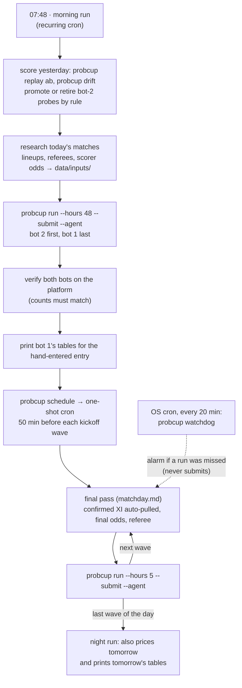

# How the system was operated

For 38 days (June 12 – July 19, 2026) a [Claude Code](https://docs.anthropic.com/en/docs/claude-code)
agent ran this system in production: it scheduled its own runs around each day's kickoffs,
researched the facts the betting market misses, ran the pricing pipeline, submitted to two
leaderboard entries, checked that the submissions landed, ran a live A/B experiment, and
wrote down everything it did and learned.

The agent did not produce forecasts. Every submitted probability came out of the
statistical pipeline (`src/probcup`). The agent's job was to feed that pipeline accurate
inputs, operate it on time, and change it only through rules agreed with the operator.

| | |
|---|---|
| Pipeline runs logged | 254 (201 of them submitting) — [logs/runs.log](logs/runs.log) |
| Submission actions logged | 17,005 creates / updates / unchanged checks across both bots |
| Run reports | 110 — [logs/run_reports.md](logs/run_reports.md) |
| Experiment decisions | every A/B verdict, promotion and retirement — [logs/experiment_log.md](logs/experiment_log.md) |
| Long-term memory | 21 notes the agent kept for itself — [memory/](memory/) |
| Settled markets | 1,183 (bot 1) and 1,035 (bot 2) |

## The daily cycle

Kickoff times moved every day, so fixed-time runs kept missing the window between the lineup
release (~60 minutes before kickoff) and the deadline (kickoff). The morning run solves this by
scheduling the day's passes itself: [`probcup schedule`](../src/probcup/ops/schedule.py) reads
the real kickoffs and prints a cron expression for 50 minutes before each wave, and the agent
turns each one into a one-shot job. A late fire costs freshness, never correctness: the
pipeline refuses to submit to a market whose kickoff has passed.

## The playbooks

The agent's standing instructions are three slash-command files, written as checklists:

- [`morning_run.md`](../.claude/commands/morning_run.md) — evaluate, research, set bot 2's
  experiment, submit both bots, print tables, schedule the day.
- [`matchday.md`](../.claude/commands/matchday.md) — the per-wave final pass: strategy review,
  lineups, player research, scorer odds, referee, submit, verify, calibration check, report.
- [`night_run.md`](../.claude/commands/night_run.md) — the last wave of the day, plus tomorrow.

They are updated here for the restructured `probcup` commands; the exact versions that ran are
at the [`tournament-final`](../../../tree/tournament-final/.claude/commands) tag.

## Who did what

| | Responsibility |
|---|---|
| **Pipeline** | Every probability. Odds-anchored goal model, count models, player props, one pricer per match. |
| **Agent** | Inputs the market misses (confirmed lineups, referee strictness, de-margined scorer odds), written to the per-match override files in `data/inputs/` — never a raw probability. Running the pipeline on schedule, verifying submissions, running the A/B bench, writing reports and memory. |
| **Operator** | Objectives, approvals and the rules: standing authorization for bot-1 submissions (June 12) and for promoting validated probes (July 2), the quality-over-coverage policy, the final-day objectives. |

## Guardrails

- **Inputs, not numbers.** Research enters only through `data/inputs/*.yaml`, each entry scoped
  to one match name. A scorer price researched for one opponent expires loudly if it would be
  reused against the next one; a confirmed lineup applies only to its own fixture.
- **Bot 1 is sacred; bot 2 is the bench.** Bot 1 changes only when a bot-2 probe wins ~8–10
  of its own settled markets in a consistent direction (counted only after bot 1's last change
  to that constant, to avoid crediting old results to a new setting), or for a high-confidence
  bug fix. Everything else stays a probe. See [docs/strategy.md §8](../docs/strategy.md).
- **Contamination-safe order.** Both bots are priced from the same odds, then bot 2 is
  submitted first and bot 1 last, so the stable values are always the final write.
- **Verify, don't trust the summary.** After every pass the agent queries both bots on the
  platform and compares open-prediction counts.
- **Quality over coverage.** No mechanical fallback ever submits. A skipped refresh costs only
  freshness (the previous submission stands); a careless one can cost points. When a run is
  missed, the [watchdog](../src/probcup/ops/watchdog.py) raises an alarm and a human triggers
  the researched run.

## What went wrong, and what changed because of it

| Date | Incident | Fix that stayed |
|---|---|---|
| Jun 13 | The first scheduled run failed: `Unknown command: /matchday` (slash commands register only at session start). | Scheduled prompts became self-contained: "read `.claude/commands/matchday.md` and execute it". |
| Jun 16 | Bot 2 had been empty since launch while every pass reported "bot 2: unchanged" — the dual submit was reading bot 1's state. About 15 matches were lost for bot 2. | Each bot is submitted its own values explicitly, and every pass verifies both bots' counts on the platform. |
| Jun 24 | A uniform "low-event" multiplier on every count stat dropped bot 1 from about #50 to #94. | Per-stat calibration validated out of sample; standing rule: never ship a uniform global dial. |
| Jun 26 | A stale "benched" override priced a starter at 5% to register a shot on target. | [ESPN lineup puller](../src/probcup/sources/espn_lineups.py): writes nothing unless a full XI is posted, flags names it can't match, scopes minutes to the match; plus a staleness guard on global overrides. |
| Jun 28 | Knockout boards re-phrased questions ("…in regulation (90 minutes + stoppage time)") and the parser rejected them. | Phrasing normalization, and a coverage rule: new question families are built and tested the same day. A [backlog scanner](../src/probcup/pipeline/backlog.py) records every unparsed question. 19 families were added in the knockouts. |
| Jul 7 | A promotion candidate looked like a 10/13 winner, but the wins came from before bot 1's last change. | Confound filter: only settlements after bot 1's latest level count toward a promotion. |
| Jul 11 | A computer restart wiped the session's crons; a morning run and a final pass never fired. | Two layers: session crons run the researched passes; a durable OS cron runs the alert-only watchdog. |
| Jul 13 | The watchdog false-alarmed on a day without games. | A run with nothing to price still writes the heartbeat. |
| Jul 15 | A stale score-or-assist share on a 5-goal forward (−94 points, the worst single market). | The score-or-assist sweep: every S/A price must sit at or above the de-margined scorer price plus an assist uplift. |

## Memory

Context windows end and sessions restart, so nothing important lived only in the conversation.
The agent kept [21 memory notes](memory/) (decisions, root causes, constants and why they were
chosen, operating rules), indexed in [`memory/MEMORY.md`](memory/MEMORY.md), which loads at the
start of every session. Together with the playbooks, [docs/strategy.md](../docs/strategy.md),
the experiment file and the logs, they let a fresh session pick up mid-tournament and operate
identically. The notes are published verbatim, written by the agent for itself, so they are
dense and full of shorthand.

## How it evolved

[timeline.md](timeline.md) follows the 40 days: each operator directive (paraphrased) and what
changed in the system as a result.
