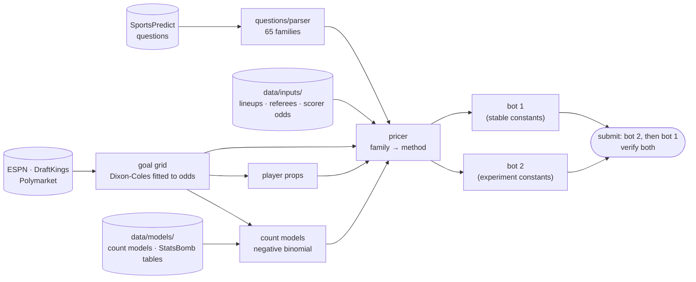

# Architecture

Everything lives in one package, [`src/probcup`](../src/probcup), driven by one command,
`probcup` ([cli.py](../src/probcup/cli.py)). The model never estimates team strength itself:
the betting market already does that better than any model we could fit, so the system takes
the market's view of the match and derives everything else from it consistently.

## One forecast, end to end

1. **The board.** [`ProbabilityCup`](../src/probcup/sportspredict/cup.py) caches every open
   match and market from the platform (`data/cache/snapshot.json`).
2. **The question.** [`parse()`](../src/probcup/questions/parser.py) turns question text into
   a `MarketSpec` (family, team, player, stat, threshold, period). About 100 small regex rules
   cover every template seen in the tournament; anything unrecognized raises and is logged by
   the [backlog scanner](../src/probcup/pipeline/backlog.py), never priced by guesswork.
3. **The odds.** [`get_anchors`](../src/probcup/pipeline/build.py) takes the de-margined 1X2
   and over/under line from ESPN (DraftKings) and averages the 1X2 with Polymarket's, flagging
   disagreements over 10 points. A dated manual override exists for fixtures ESPN lacks.
4. **The goal grid.** [`ScorelineModel.from_market`](../src/probcup/models/goals.py) solves
   for the two teams' scoring rates and the Dixon-Coles low-score correction that reproduce
   those odds. Every goal question (win, draw, both teams score, margins, halves, first goal,
   extra time, shootouts) is a sum over cells of this one scoreline grid, so the answers can't
   contradict each other.
5. **Counts.** [`CountPricer`](../src/probcup/models/counts.py) predicts corners, cards, shots
   on target, fouls and offsides for each team as negative-binomial counts whose means come
   from regressions on ~116k club matches *with the odds-implied scoring rates as inputs*, so
   they transfer to any fixture. Tournament corrections and the referee's strictness scale
   the means. Totals are exact convolutions of the two teams' distributions; "more X than"
   comparisons enumerate both, with ties resolving to No.
6. **Players.** [`PlayerModel`](../src/probcup/models/players.py) prices scorers and shots on
   target from per-match rates, the team's expected output, and the player's expected minutes,
   which come from the ESPN starting XI pulled automatically 100 minutes before kickoff
   ([espn_lineups.py](../src/probcup/sources/espn_lineups.py)). A de-margined anytime-scorer
   price, when the agent has researched one for this exact fixture, replaces the model.
7. **The price.** [`MatchPricer`](../src/probcup/models/pricer.py) routes the family to its
   method: one line per family. A few families are shrunk toward a structural baseline by
   backtest-derived weights.
8. **Submission.** [`probcup run`](../src/probcup/pipeline/run.py) prices every market in the
   horizon for bot 1, reprices the same markets for bot 2 under its experiment, submits bot 2
   then bot 1 through `ProbabilityCup.submit()` (create, update, or leave unchanged; never past
   kickoff), and logs every run and every submission.

## Two kinds of numbers

- **Tuned constants** — tournament intensities, total-only scales, the timing scale, the
  referee cap, priors, blend weights — all live in
  [`models/calibration.py`](../src/probcup/models/calibration.py), each with the evidence that
  set it. The models read them at call time, which is what makes bot 2 possible.
- **Measured tables** — StatsBomb conditionals (brace rates, goal methods, substitute scorers,
  hold-the-lead, full-90 shares) — sit next to the model code that uses them, each traced to a
  study in [research/](../research/README.md).

## Bot 2: experiments without a second codebase

[`pipeline/experiment.py`](../src/probcup/pipeline/experiment.py) reads
`data/inputs/bot2_experiment.yaml` and, inside a context manager, swaps any of eight
calibration constants for one pricing pass, restoring them even on error. Both bots see
identical odds and inputs, so the strategy is the only difference between them. Results are
scored with `probcup replay ab`, and a probe is promoted into `calibration.py` only after it
wins enough of its own settled markets (see [strategy.md §8](strategy.md)).

## Operations

| Piece | Role |
|---|---|
| [`ops/schedule.py`](../src/probcup/ops/schedule.py) | prints a cron line 50 min before each of today's kickoff waves, for the agent's one-shot jobs |
| [`ops/heartbeat.py`](../src/probcup/ops/heartbeat.py) | every agent run touches `data/logs/agent_last_run` |
| [`ops/watchdog.py`](../src/probcup/ops/watchdog.py) | durable OS cron: alarms (sticky file, log, desktop) when the morning run or a pre-kickoff pass is missing; never submits |
| [`sportspredict/verify.py`](../src/probcup/sportspredict/verify.py) | reconciles the submission log with what the platform stored |
| [`.claude/commands/`](../.claude/commands/) | the agent's playbooks: morning run, per-wave final pass, night run |

## Evaluation

- [`evaluation/club_backtest.py`](../src/probcup/evaluation/club_backtest.py) — walk-forward
  over club seasons with closing odds: rebuild the pricer for every match and score a battery
  of synthetic questions against what happened.
- [`evaluation/ledger.py`](../src/probcup/evaluation/ledger.py) — the per-market ledger of us
  vs the crowd, from the hand-copied history.
- [`evaluation/replay.py`](../src/probcup/evaluation/replay.py) — exact RBP replay of policies
  on settled markets with game-clustered bootstrap intervals, walk-forward fitting, and the
  bot-2-vs-bot-1 comparison used to promote probes.
- [`evaluation/drift.py`](../src/probcup/evaluation/drift.py) — per-family calibration gap on
  settled markets; a drift flag starts a large-sample check, it never changes the model itself.

## Testing

`make test` runs offline in about 30 seconds: parser coverage over every real question, model
invariants (the grid is a distribution, advancement probabilities sum to one, experiments
always restore), the lineup and override safety cases, and the
[golden tests](../tests/golden/README.md), which hold the whole system to exactly what the
code that ran the final did.
