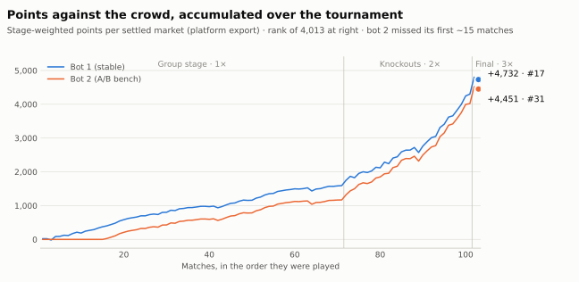
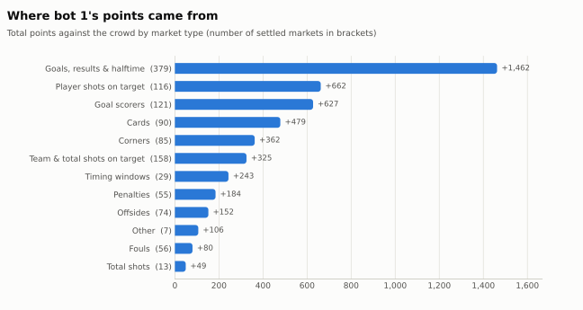
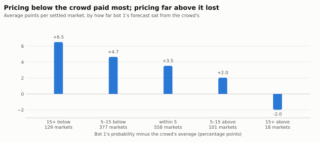
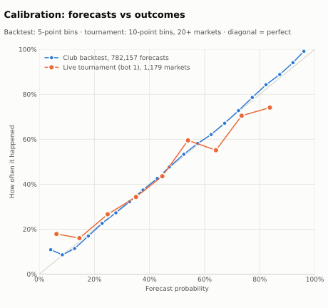

# Results

| Entry | Overall rank | Knockout-stage rank | Points | Settled markets | Brier | Beat the crowd on |
|---|---|---|---|---|---|---|
| Bot 1 (stable) | **#17** of 4,013 | #8 | +4,732 | 1,183 | 0.2197 | 69.1% of markets |
| Bot 2 (A/B bench) | #31 | **#5** | +4,451 | 1,035 | 0.2174 | 69.7% |

Ranks are from the final leaderboard; everything else is computed from the platform's
settled-results export in [results/data/](../results/data/) (its points sum to the leaderboard
totals within rounding). Figures are rebuilt by
[results/make_figures.py](../results/make_figures.py); every chart's numbers are in a CSV next
to the export.

<picture>
  <source media="(prefers-color-scheme: dark)" srcset="../results/figures/cumulative_points-dark.svg">
  
</picture>

Nearly two-thirds of bot 1's points (63%) came after the group stage, where forecasts counted
double, and it took +501.6 on the final alone (3×), which moved it from 31st to 17th overnight. Bot 2's
line is flat for the first ~15 matches: it was silently receiving nothing until the
verification step caught it.

## Where the points came from

<picture>
  <source media="(prefers-color-scheme: dark)" srcset="../results/figures/points_by_category-dark.svg">
  
</picture>

Per market, the soft count and prop markets earned the most: timing windows +8.4, player
shots on target +5.7, cards +5.3, goal scorers +5.2, corners +4.3, against +3.9 on goals and
results, where the crowd follows the same betting market we anchor to. That is the edge the
strategy was built around ([strategy.md §6](strategy.md)): the crowd systematically
over-prices events on niche count markets and follows the raw quote on star scorers, while it
is hard to beat on results and goal totals. Fouls were the weakest family (+1.4 per market,
better than the crowd only 38% of the time). Full table:
[points_by_category.csv](../results/data/points_by_category.csv).

## Disagreeing with the crowd

<picture>
  <source media="(prefers-color-scheme: dark)" srcset="../results/figures/points_by_deviation-dark.svg">
  
</picture>

Bot 1 priced 5+ points below the crowd on 506 markets and 5+ above it on 119. Going lower
paid better the further it went (+6.5 per market at 15+ points below); going far above lost (18 markets, −2.0
each). Even forecasts within 5 points of the crowd earned +3.5 each, because the score
compares you with the average participant's Brier, which is worse than the Brier of the
average forecast ([competition.md](competition.md#scoring)).

## Calibration

<picture>
  <source media="(prefers-color-scheme: dark)" srcset="../results/figures/calibration-dark.svg">
  
</picture>

The walk-forward club backtest (June 13; 782,157 forecasts over 19 market families) tracks the
diagonal within 2 percentage points in every bin from 5% to 95%, and beat an always-50%
forecast in all 19 families and the historical base rate in 17 ([backtest_report.csv](../results/data/backtest_report.csv),
[notebook](../notebooks/02_backtest_report.ipynb)). Live, with 27–317 markets per bin, the
tournament forecasts follow it with more noise; the 80%+ bin came in low (84% forecast, 74%
happened, n = 27).

## Reproducing the final

`probcup demo` reprices the World Cup final's 20 markets offline from the archived code and
inputs. Given odds recovered from four goal markets, 19 of the 20 forecasts equal what bot 1
submitted to the whole percent (the twentieth is 92 vs 91), which is direct evidence that this
repository is the system that ran.

## Experiments

Bot 2 tested one family of changes at a time against bot 1's live configuration. Five
constants were promoted to bot 1: four on July 2 (a favourite shots-on-target boost, total
cards 0.85, total shots on target 1.50, total offsides 1.10) and the timing scale (0.85) on
July 10. The next notch of each was then probed and retired after losing live (cards 0.80,
timing 0.70, total shots on target 1.60). Every verdict is in
[agent/logs/experiment_log.md](../agent/logs/experiment_log.md). The lessons that became
standing rules are in [strategy.md §11](strategy.md).
